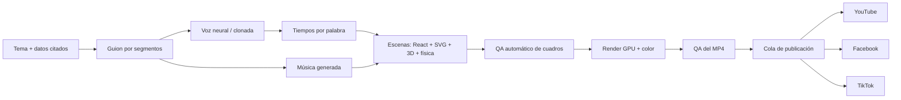

# Estudio Andino · fábrica de videos de ciencia en español

Sistema propio que **escribe, narra, anima, revisa y publica** videos de divulgación científica y memes 3D en español,
casi sin intervención manual. Corre en una PC con GPU y usa código, no editores de video.

> Este repositorio es **solo la ficha técnica**: explica cómo funciona, qué hace y qué no.
> El código fuente, las plantillas, las voces y las credenciales **no están publicados**.

🌐 Página: https://andinoworks.github.io/estudio-andino/

---

## Qué produce

| Formato | Tamaño | Duración | Dónde |
|---|---|---|---|
| Video largo explicativo | 1920×1080 | 6–15 min | YouTube, Facebook |
| Short / Reel | 1080×1920 | 20–60 s | YouTube Shorts, Facebook Reels, TikTok |
| Clips verticales | 1080×1920 | 15–90 s | cortados automáticamente del video largo |
| Meme 3D "de escalada" | 1080×1920 | 30–50 s | Shorts / Reels |
| Miniaturas | 1280×720 | — | generadas con la misma escena del video |

Más de **85 producciones** y **150 archivos finales** renderizados entre octubre y noviembre de 2026.

## Cómo trabaja (resumen)

1. **Guion** dividido en segmentos con capítulos; las palabras clave se marcan para resaltarlas. Datos exactos con autor y año.
2. **Voz**: síntesis neural en español latino o voces clonadas en GPU local; se audita que ninguna toma salga cortada.
3. **Sincronía**: cada palabra tiene su cuadro exacto, así las animaciones "caen" justo cuando se nombra algo.
4. **Música** original generada por código (pop, dream, drive, phonk), sin derechos de terceros.
5. **Escenas** escritas como componentes: gráficos vectoriales, fórmulas, 3D en tiempo real, simulaciones deterministas
   y escenas con física real (cuerpos rígidos, personajes con esqueleto) renderizadas en Blender sin interfaz.
6. **Control de calidad** antes y después del render (ver abajo).
7. **Publicación** programada con títulos, descripciones, capítulos y miniatura.

Detalle completo: [guia/pipeline.md](guia/pipeline.md) · Arquitectura: [guia/arquitectura.md](guia/arquitectura.md)

## Características

- **Todo es código**: un video es un archivo de datos + componentes; cambiar un número re-renderiza el video entero.
- **Subtítulos palabra por palabra** en la zona segura inferior, sin tapar la interfaz de las apps verticales.
- **Kit visual propio**: paleta, tipografías, contadores, citas, 3D en SVG, transiciones (paneo, destello, iris, cristal…).
- **3D real** (Three.js) y **física realista** (Blender headless: caídas, choques, polvo, profundidad de campo).
- **Ritmo medido**: un analizador mide cortes cada 10 s y movimiento; los Shorts apuntan a planos ≤ 3,5 s,
  como las referencias virales.
- **QA automático** que bloquea el render si hay textos encimados, cortados por el borde o demasiado chicos.
- **QA del archivo final**: negro al inicio, imagen congelada, silencios (voz cortada), volumen (LUFS) y picos.
- **Looks de color** (documental, cine, cálido, frío, película) aplicados con LUT propias.
- **Render acelerado por GPU** (NVENC) y lotes nocturnos.
- **Centro de control local**: panel web en la PC con cola de publicación por hora, estado de tareas, logs y
  estadísticas de retención (promedio visto, % que sigue a los 3 s).
- **Reglas anti-penalización**: nada de publicar en ráfagas, nada de "etiquetá a un amigo", verificación de cada subida.
- **Bilingüe**: algunos memes salen en español e inglés desde el mismo proyecto.

## Alcance y límites

Ver [guia/alcance.md](guia/alcance.md). En corto:

- ✅ Divulgación científica, explicadores, memes 3D, promos de marca.
- ✅ Producción diaria automática (pausable), con revisión humana opcional.
- ❌ No genera video "foto-realista" con IA de pago: prioriza animación, datos y física simulada.
- ❌ No es un servicio público ni un SaaS: corre en una sola máquina.

## ¿Por qué corre en una PC y no en GitHub/la nube?

Explicado en [guia/local-vs-nube.md](guia/local-vs-nube.md). Resumen: la voz clonada, Blender y el render necesitan
**GPU**, que los servidores gratuitos de GitHub Actions no tienen; las sesiones de las redes sociales y las claves
quedan más seguras en la máquina; y el costo es cero.

## Tecnologías

Remotion (React → video) · TypeScript · Three.js / @remotion/three · KaTeX · Python · FFmpeg · Blender 4.2 ·
TTS neural y modelos de voz locales · APIs de YouTube Data y Graph de Meta · Programador de tareas de Windows.

## Contacto

¿Querés un video, una serie o este sistema para tu marca? Abrí un *issue* en este repositorio
o escribí desde https://andinoworks.github.io.

---
© 2026 Andinoworks. Texto e imágenes: todos los derechos reservados. Ver [LICENSE](LICENSE).
