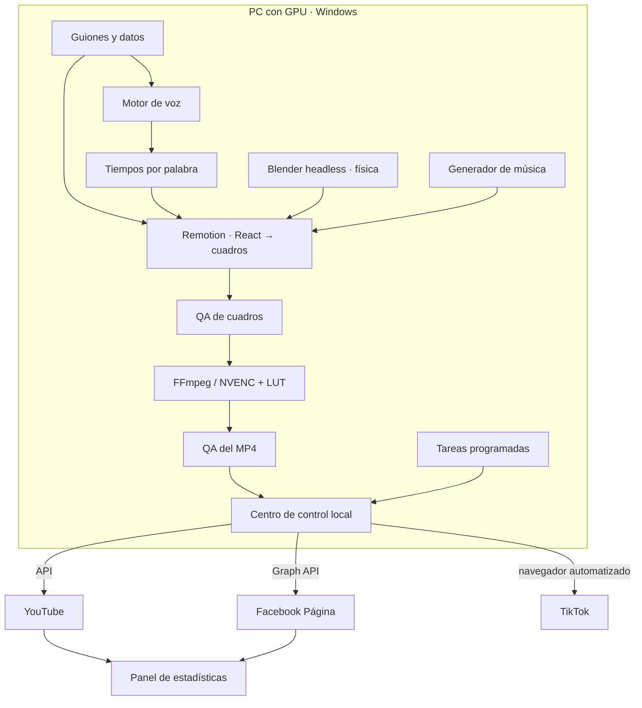

# Arquitectura

## Piezas
| Pieza | Función |
|---|---|
| Motor de escenas | Remotion 4 + TypeScript. Bibliotecas propias: estudio visual, 3D en SVG, sincronía, zonas seguras, memes 3D, formato documental. |
| Voz | TTS neural en la nube + modelos locales en GPU (clonación). Auditoría de truncado. |
| Física | Blender 4.2 sin interfaz, escenas descriptas en JSON (objetos, masas, cámara, polvo). |
| Música | Síntesis por código, sin samples con derechos. |
| QA | Medición del DOM en cada cuadro + análisis del MP4 (negros, congelados, silencios, LUFS). |
| Centro de control | Servidor web local (solo 127.0.0.1): videos terminados, cola por hora, tareas, logs, retención. |
| Automatización | Tareas de Windows: video diario, cola de Shorts, panel de estadísticas, reparación de red. |
| Publicación | YouTube Data API v3, Graph API de Meta, TikTok vía navegador con verificación posterior. |

## Seguridad
- Las claves y sesiones viven solo en la PC; nada de eso está en este repositorio.
- El Centro de control escucha solo en la máquina local y exige una cabecera propia para las acciones.
- Textos de publicación siempre en UTF-8 desde Python para evitar caracteres rotos.
